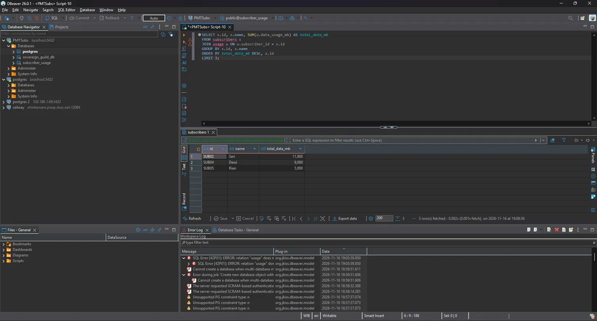
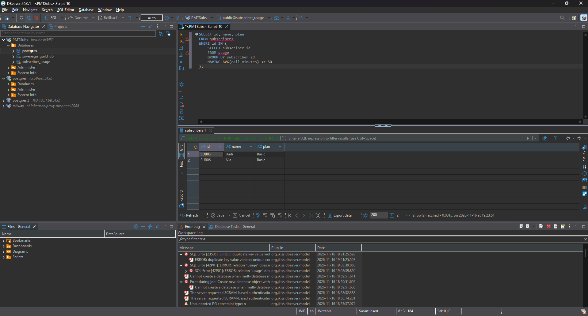

# Subscriber Usage Service

A lightweight REST API that records and retrieves subscriber usage data (call minutes, SMS count, and data usage). The project also includes automated CSV snapshot scripts, a PostgreSQL schema, and a bug-fix exercise.

---

## Project structure

```
subscriber-usage/
├── src/
│   ├── app.js               # Express app — routes and in-memory store
│   └── server.js            # Calls app.listen (entry point for npm start)
├── scripts/
│   ├── snapshot.js          # Q2: fetch API → write dated CSV
│   ├── cleanup.js           # Q2: delete snapshots older than RETENTION_DAYS
│   └── crontab.example      # Q2: cron schedule examples (WIB and UTC)
├── sql/
│   ├── 01_schema.sql        # Q3: CREATE TABLE subscribers, usage
│   ├── 02_seed.sql          # Q3: INSERT sample data
│   └── 03_queries.sql       # Q3: INSERT, UPDATE, and SELECT queries
├── q4/
│   ├── getTotalUsageMB.js   # Q4: fixed function + buggy original in comment
│   └── EXPLANATION.md       # Q4: root-cause analysis and prevention guide
├── tests/
│   ├── usage.test.js        # Q1: API endpoint tests
│   ├── q2.test.js           # Q2: snapshot and cleanup helper tests
│   └── q4.test.js           # Q4: getTotalUsageMB tests
├── docs/
│   └── q3/                  # Q3: DBeaver screenshots
├── snapshots/               # (git-ignored) CSV snapshots written by snapshot.js
├── logs/                    # (git-ignored) cron log output
├── package.json
└── README.md
```

---

## Prerequisites

- **Node.js** v18 or later (uses built-in `fetch` and `node:test`)
- **npm** (bundled with Node.js)
- **PostgreSQL** (only required for Q3 — independent of the Node API)

---

## Install & Run

```bash
# 1. Install dependencies (Express only)
cd subscriber-usage
npm install

# 2. Start the API server (default port: 3000)
npm start

# 3. Optional: use a custom port
PORT=8080 npm start
```

---

## Q1 — Subscriber Usage REST API

### API Documentation

All routes are prefixed with `/api/usage`.

---

#### `POST /api/usage`

Record a new usage entry.

**Request body** (JSON):

| Field | Type | Rules |
|---|---|---|
| `subscriberId` | string | Required, non-empty |
| `callMinutes` | number | Finite, ≥ 0 |
| `smsCount` | number | Finite, ≥ 0 |
| `dataUsageMB` | number | Finite, ≥ 0 |

**Success — 201 Created:**

```json
{
  "id": 1,
  "subscriberId": "sub-001",
  "callMinutes": 10,
  "smsCount": 5,
  "dataUsageMB": 100.5,
  "timestamp": "2026-11-16T11:00:00.000Z"
}
```

**Validation failure — 400 Bad Request:**

```json
{
  "errors": [
    "subscriberId must be a non-empty string",
    "callMinutes must be a finite, non-negative number"
  ]
}
```

**curl example:**

```bash
curl -s -X POST http://localhost:3000/api/usage \
  -H "Content-Type: application/json" \
  -d '{"subscriberId":"sub-001","callMinutes":10,"smsCount":5,"dataUsageMB":100.5}'
```

---

#### `GET /api/usage`

List all records. Optionally filter by subscriber.

**Query parameters:**

| Param | Type | Description |
|---|---|---|
| `subscriberId` | string | *(optional)* Return only records for this subscriber |

**Response — 200 OK:**

```json
{
  "count": 2,
  "data": [
    {
      "id": 1,
      "subscriberId": "sub-001",
      "callMinutes": 10,
      "smsCount": 5,
      "dataUsageMB": 100.5,
      "timestamp": "2026-11-16T11:00:00.000Z"
    },
    {
      "id": 2,
      "subscriberId": "sub-002",
      "callMinutes": 3,
      "smsCount": 0,
      "dataUsageMB": 20,
      "timestamp": "2026-11-16T11:01:00.000Z"
    }
  ]
}
```

**curl examples:**

```bash
# All records
curl -s http://localhost:3000/api/usage

# Filtered
curl -s "http://localhost:3000/api/usage?subscriberId=sub-001"
```

---

#### `GET /api/usage/:subscriberId`

List all records for a specific subscriber.

**Success — 200 OK:**

```json
{
  "count": 1,
  "data": [
    {
      "id": 1,
      "subscriberId": "sub-001",
      "callMinutes": 10,
      "smsCount": 5,
      "dataUsageMB": 100.5,
      "timestamp": "2026-11-16T11:00:00.000Z"
    }
  ]
}
```

**Not found — 404:**

```json
{
  "error": "No records found for subscriber \"ghost\""
}
```

**curl examples:**

```bash
# Known subscriber
curl -s http://localhost:3000/api/usage/sub-001

# Unknown subscriber → 404
curl -s http://localhost:3000/api/usage/ghost
```

---

### Design Decisions

#### HTTP status codes

| Code | When used |
|---|---|
| **201 Created** | A `POST` that successfully creates a resource should use 201 rather than 200 to signal that a new resource was created and to distinguish it from reads or other mutations. |
| **400 Bad Request** | The client sent data that failed validation. All validation errors are collected and returned in one response so the client can fix everything in a single round-trip. |
| **404 Not Found** | `GET /api/usage/:subscriberId` returns 404 when no records exist for that subscriber. The plain `GET /api/usage?subscriberId=` variant returns 200 with an empty list because a filtered collection query that returns nothing is not an error — the resource (the collection) exists. |

#### Server-generated timestamp

The timestamp is generated inside the POST handler at the moment the record is stored (`new Date().toISOString()`), not taken from the client. This guarantees:

1. **Consistency** — all timestamps are in UTC ISO 8601 format regardless of the client's locale or timezone.
2. **Trustworthiness** — clients cannot backdate or forwardate records.

#### ID auto-increment

A simple module-level counter (`nextId`) is used. Because Node.js is single-threaded, incrementing the counter before assigning it is race-condition-free for a single process. This is intentional for an in-memory store — a database primary key would be used in production.

#### App / server separation

`src/app.js` creates and exports the Express `app` without calling `app.listen`. `src/server.js` imports `app` and calls `listen`. This lets the test suite call `app.listen(0)` on a free port without port conflicts, and makes the app trivially testable without starting a persistent server.

---

## Q2 — Usage Snapshot Automation

### How it works

Two scripts work together to automate periodic data exports:

| Script | Purpose |
|---|---|
| [`scripts/snapshot.js`](scripts/snapshot.js) | Fetches all usage records from the running API and writes them to a dated CSV file |
| [`scripts/cleanup.js`](scripts/cleanup.js) | Deletes snapshot CSV files whose filename date is older than the retention window |

The snapshot script is designed to be called by a scheduler (cron / Task Scheduler) three times a day. Each run writes one file; the cleanup script removes files that have aged past the retention limit.

> **Note — in-memory storage:** The API stores all data in memory. If the server restarts, all records are lost. Snapshots therefore only contain data collected since the server last started. For durable storage, replace the in-memory `records` array in `src/app.js` with a real database.

---

### Environment variables

| Variable | Default | Description |
|---|---|---|
| `API_URL` | `http://localhost:3000` | Base URL of the running subscriber-usage API |
| `SNAPSHOT_DIR` | `./snapshots` | Directory where CSV files are written and read |
| `RETENTION_DAYS` | `30` | Number of days to keep snapshot files (cleanup script) |

---

### File naming convention

```
usage_snapshot_YYYYMMDD_HHmm_WIB.csv
```

Example: `usage_snapshot_20261116_0800_WIB.csv`

- **Date and time are always in WIB (Asia/Jakarta, UTC+7)**, regardless of the timezone the server runs in. This is enforced with `Intl.DateTimeFormat({ timeZone: 'Asia/Jakarta' })`, not local system time.
- The `_WIB` suffix makes the timezone unambiguous for anyone reading the filename.
- The cleanup script parses the age of a file from this embedded date, so it is immune to `mtime` drift caused by copies or backups.

---

### Running both scripts manually

```bash
# Take a snapshot right now (server must be running first)
npm start &           # start the API in the background
npm run snapshot

# Or with a custom API URL / output directory
API_URL=http://my-server:3000 SNAPSHOT_DIR=/data/snapshots npm run snapshot

# Clean up files older than 30 days
npm run cleanup

# Preview what would be deleted without actually deleting (dry run)
node scripts/cleanup.js --dry-run

# Custom retention window (e.g. 7 days)
RETENTION_DAYS=7 npm run cleanup
```

---

### Installing the cron jobs

See [`scripts/crontab.example`](scripts/crontab.example) for the full reference with two options:

**Option A — using `CRON_TZ` (recommended when your cron supports it):**

```cron
CRON_TZ=Asia/Jakarta
0  8 * * * /usr/bin/node /path/to/subscriber-usage/scripts/snapshot.js >> /path/to/subscriber-usage/logs/snapshot.log 2>&1
0 12 * * * /usr/bin/node /path/to/subscriber-usage/scripts/snapshot.js >> /path/to/subscriber-usage/logs/snapshot.log 2>&1
0 15 * * * /usr/bin/node /path/to/subscriber-usage/scripts/snapshot.js >> /path/to/subscriber-usage/logs/snapshot.log 2>&1
0  1 * * * /usr/bin/node /path/to/subscriber-usage/scripts/cleanup.js  >> /path/to/subscriber-usage/logs/snapshot.log 2>&1
```

**Option B — UTC-converted times** (use when `CRON_TZ` is not supported; WIB = UTC+7):

```cron
# 08:00 WIB = 01:00 UTC  |  12:00 WIB = 05:00 UTC  |  15:00 WIB = 08:00 UTC
0  1 * * * /usr/bin/node /path/to/subscriber-usage/scripts/snapshot.js >> logs/snapshot.log 2>&1
0  5 * * * /usr/bin/node /path/to/subscriber-usage/scripts/snapshot.js >> logs/snapshot.log 2>&1
0  8 * * * /usr/bin/node /path/to/subscriber-usage/scripts/snapshot.js >> logs/snapshot.log 2>&1
# 01:00 WIB = 18:00 UTC previous day
0 18 * * * /usr/bin/node /path/to/subscriber-usage/scripts/cleanup.js  >> logs/snapshot.log 2>&1
```

Create the `logs/` directory before installing: `mkdir -p logs`

Install with: `crontab -e` (then paste the lines above, adjusting paths).

**Windows — Task Scheduler:** See the Windows section at the bottom of [`scripts/crontab.example`](scripts/crontab.example) for ready-to-run `schtasks` commands.

---

## Q3 — Subscriber & Usage SQL (PostgreSQL)

This part is **independent of the Node API**. The API uses in-memory storage; the SQL files model the same domain in a proper relational database.

### Files

| File | Purpose |
|---|---|
| [`sql/01_schema.sql`](sql/01_schema.sql) | Drops and recreates `subscribers` and `usage` tables (safe to re-run) |
| [`sql/02_seed.sql`](sql/02_seed.sql) | Inserts 6 subscribers and 8 usage records |
| [`sql/03_queries.sql`](sql/03_queries.sql) | INSERT, UPDATE, and three SELECT queries with expected results |

---

### How to run

**1. Create the database** (psql or any PostgreSQL client):

```sql
CREATE DATABASE subscriber_usage;
```

**2. Run the files in order** against the `subscriber_usage` database:

```
01_schema.sql  →  02_seed.sql  →  03_queries.sql
```

**In DBeaver:**
1. Open the file (File → Open File or drag into the editor).
2. Confirm the active database is `subscriber_usage` (shown in the toolbar).
3. For `01_schema.sql` and `02_seed.sql`: press **Alt+X** to run the entire script.
4. For `03_queries.sql`: place the cursor inside each statement and press **Ctrl+Enter** to run them one at a time.

**In psql:**

```bash
psql -d subscriber_usage -f sql/01_schema.sql
psql -d subscriber_usage -f sql/02_seed.sql
psql -d subscriber_usage -f sql/03_queries.sql
```

> **Re-run note:** Queries 1 and 2 in `03_queries.sql` insert and update `SUB07`. Running them a second time will fail with a duplicate-key error. To reset, re-run `01_schema.sql` and `02_seed.sql` first (they drop and recreate all tables).

---

### Expected results

**Query 3 — Total data usage for Premium subscribers:**

| total_premium_data_mb |
|---|
| 16800 |

> SUB02 (Sari): 6000 + 5800 = 11800; SUB05 (Rian): 5000; SUB07 (Fajar, upgraded to Premium, no usage rows): 0. Total = 16800.

**Query 4 — Top 3 subscribers by total data usage:**

| id | name | total_data_mb |
|---|---|---|
| SUB02 | Sari | 11800 |
| SUB04 | Dewi | 9000 |
| SUB05 | Rian | 5000 |

**Query 5 — Subscribers with average call minutes ≤ 30:**

| id | name | plan |
|---|---|---|
| SUB03 | Budi | Basic |
| SUB06 | Nia | Basic |

---

### Design choices

| Choice | Reason |
|---|---|
| `DATE` for `activation_date` | Activation is a calendar date with no time component; `DATE` is the precise type and avoids timezone confusion. |
| `recorded_at TIMESTAMP` instead of `timestamp` | `timestamp` is a PostgreSQL type name. Using it as a column name is legal but confusing and can cause parse errors in some tools; `recorded_at` is unambiguous. |
| `CHECK (plan IN ('Basic', 'Premium', 'Family'))` | Enforces the allowed plan values at the database level, independent of application logic. |
| Foreign key `usage.subscriber_id → subscribers.id` | Guarantees referential integrity: a usage row cannot exist for a non-existent subscriber. `DROP TABLE … CASCADE` in the schema script handles the dependency order on reset. |
| `CREATE INDEX idx_usage_subscriber_id` | Queries that filter or join on `subscriber_id` (the most common access pattern) benefit from an index on that column. |

---

### Screenshots

**1. Insert Fajar (Query 1)**


**2. Update plan to Premium (Query 2)**


**3. Total data usage for Premium subscribers — 16,800 (Query 3)**


**4. Top 3 by data usage (Query 4)**



**5. Average call minutes ≤ 30 — subquery (Query 5)**



---

## Q4 — Troubleshoot & Explain

### Root cause

The original function had two bugs:

```js
// BUGGY
function getTotalUsageMB(records) {
  return records.reduce((total, record) => {
    total += record.dataUsageMB; // mutates local copy only — never returned
  });                             // callback implicitly returns undefined → NaN
}
```

1. **Missing `return`** — the block-body callback mutates the local `total` parameter but never returns it. `reduce` receives `undefined` as the next accumulator, so the result is `NaN` after the second element.
2. **No initial value** — without a second argument, `reduce` uses the first record *object* as the starting accumulator. This throws `TypeError` on an empty array and returns the object itself for a single-element array.

### The fix

```js
function getTotalUsageMB(records) {
  return records.reduce((total, record) => total + record.dataUsageMB, 0);
}
```

Expression body (no braces) so the result is returned automatically; `0` as the initial value so the accumulator is always a number.

For the full analysis — including what the buggy code returns for every edge case, ESLint rules, TypeScript, and code-review habits — see [q4/EXPLANATION.md](q4/EXPLANATION.md).

### Run the Q4 tests

```bash
node --test tests/q4.test.js
```

---

## Running all tests

```bash
npm test
```

The test suite covers all three implemented parts (Q1 API, Q2 snapshot/cleanup helpers, Q4 bug fix). It uses Node's built-in `node:test` runner — no external libraries required. Node 18+ is needed.

```
# tests 38  |  pass 38  |  fail 0
```

---

## Possible improvements

- Replace the in-memory `records` array in `src/app.js` with the PostgreSQL schema defined in `sql/01_schema.sql`, making data durable across server restarts.
